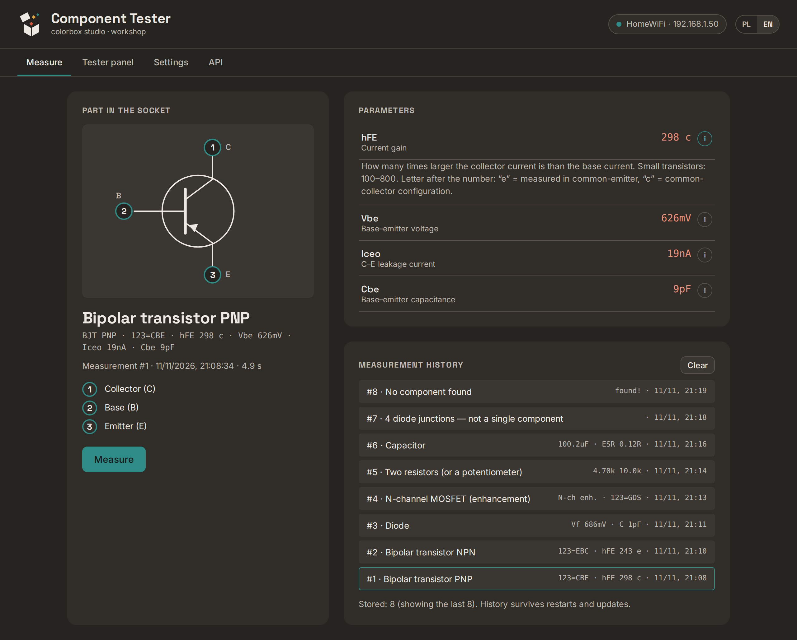
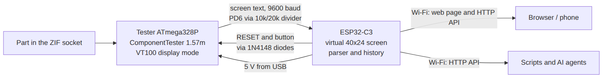

# Component Tester with Wi-Fi (LCR-T4 + ESP32-C3)

A cheap LCR-T4 style component tester (transistors, diodes, resistors, capacitors, inductors)
rebuilt into a network device: put a part into the ZIF socket, press **Measure** in your
browser — or call the HTTP API from a script or an AI agent — and get the part type, which
pin is which, and its parameters, drawn as a schematic symbol.

**Why:** the original tester only shows the result on its tiny screen. Here the result lands
in your browser and in a JSON API, with explanations of every parameter, a stored history,
and remote control of the tester's own menu (including self-adjustment). It also keeps
working when the tester's display is broken.

## What it can do

- Identify the part in the socket: bipolar transistor, MOSFET, JFET, IGBT, thyristor, triac,
  diode, resistor, capacitor, inductor — with **pin numbers** on a drawn symbol.
- Show every parameter with a short explanation and typical values (ⓘ).
- Keep the last 200 measurements; they survive restarts and updates. Each has its own link.
- Show the tester's own screen live and press its button remotely (menu, self-adjustment).
- Set up Wi-Fi from a phone (the device opens its own **Tester-Setup** network).
- Update its own firmware over Wi-Fi.
- HTTP API with Swagger documentation on the device (`/docs`).
- Web page in English or Polish (switch in the top-right corner).

## Chapters

| # | Chapter | What's inside |
|---|---|---|
| 1 | [Parts](docs/01-parts.md) | what to buy, which tester boards work, tools |
| 2 | [Tester firmware](docs/02-tester-firmware.md) | header for programming, flashing ComponentTester (one time) |
| 3 | [Wiring and assembly](docs/03-wiring-and-assembly.md) | six wires between the tester and the ESP32 |
| 4 | [ESP32 install and first start](docs/04-esp32-install.md) | flashing from the browser, Wi-Fi setup from a phone |
| 5 | [Everyday use](docs/05-using.md) | measuring, history, tester panel, self-adjustment, updates |
| 6 | [API](docs/06-api.md) | endpoints, examples, Swagger |
| 7 | [Troubleshooting](docs/07-troubleshooting.md) | symptom → cause → fix |
| 8 | [How it works](docs/08-how-it-works.md) | program structure, design decisions, building from source |

## Shortest path

Time: about 1.5–2 hours if you have all the parts (most of it is soldering and the one-time
tester flash).

1. Check the tester has a real ATmega328P ([chapter 1](docs/01-parts.md)).
2. Solder a 2×3 header and flash `release/ComponentTester.hex` with a USBasp ([chapter 2](docs/02-tester-firmware.md)).
3. Solder six wires, two resistors and two diodes to an ESP32-C3 SuperMini ([chapter 3](docs/03-wiring-and-assembly.md)).
4. Flash `release/component-tester-esp32c3-full.bin` from Chrome, join **Tester-Setup** with a phone, pick your Wi-Fi ([chapter 4](docs/04-esp32-install.md)).
5. Open `http://tester.local/`, put a part in the socket, press **Measure**.

## Repository

| Path | Contents |
|---|---|
| `release/` | ready-to-flash files: tester (`.hex`, `.eep`) and ESP32 (`.bin`) |
| `firmware/` | ESP32-C3 program (PlatformIO): `src/main.cpp`, web page `ui/index.html`, API description `ui/openapi.json` |
| `tester-firmware/` | our configuration of ComponentTester 1.57m and the diff against the original |
| `tools/` | `tester_demo.py` (web page without hardware), `tester_screenshots.py` |
| `docs/` | chapters, images, wiring source (`docs/wiring/wiring.yml`, WireViz) |

## Project status

Works end to end on one unit (LCR-T4 clone with ATmega328P-AU, ESP32-C3 SuperMini): measuring,
history, Wi-Fi setup through **Tester-Setup**, self-adjustment from the browser, updates over Wi-Fi.
Not tested: other tester variants (T3, T5, T7, GM328) — see [chapter 1](docs/01-parts.md).
Possible next steps: a MCP server for AI agents, text commands to the tester (needs one more wire).

## Licence

Our code (ESP32 program, web page, tools, documentation): MIT, see [`LICENSE`](LICENSE).
ComponentTester firmware: © Markus Reschke, EUPL v1.2 — see [`tester-firmware/README.md`](tester-firmware/README.md).
