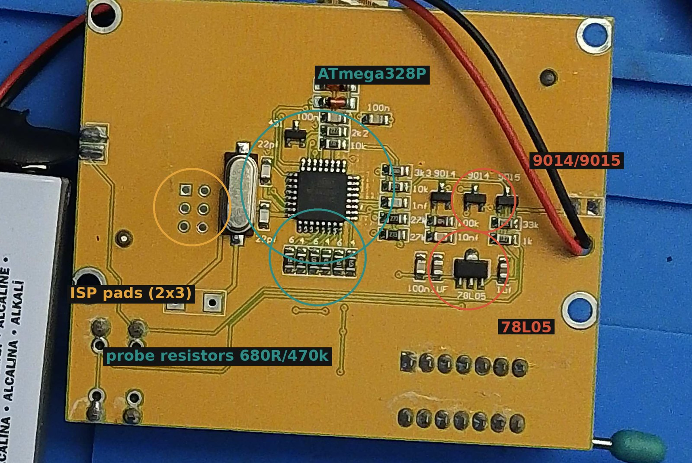

# 1. Parts

## What you need

| # | Part | What for | Approx. price |
|---|---|---|---|
| 1 | **LCR-T4 style component tester** with an **ATmega328P**, 128×64 graphic LCD and ZIF socket, 9 V battery clip | does the measuring | €6–10 |
| 2 | **ESP32-C3 SuperMini** (4 MB flash, USB-C) | Wi-Fi, web page, API; powers the tester | €3–4 |
| 3 | resistor **10 kΩ** | top half of a voltage divider (5 V → 3.3 V) on the data line | cents |
| 4 | resistor **20 kΩ** (22 kΩ also works) | bottom half of the divider | cents |
| 5 | 2× diode **1N4148** | let the ESP32 pull the tester's RESET and button lines low without ever seeing 5 V | cents |
| 6 | 2×3 pin header (2.54 mm) and some thin wire | programming header, connections | cents |
| 7 | USB-C cable and a USB power supply (or a computer) | power for everything | — |

**Tools (one time):** soldering iron, a multimeter with a continuity beeper, and a **USBasp**
programmer (€3–5) with a 10-pin to 6-pin adapter or six female–female jumper wires.

## Check the tester before you start

The ESP32 part works with any tester running ComponentTester, but the tester **must have a
genuine ATmega328P**:

- Look at the big square chip (32 pins). It should read **MEGA328P**.
- Newer "T4" boards are sometimes sold with an **APT32F172K8T6 carrying a fake Atmel marking**,
  or an **LGT8F328**. These do not work with ComponentTester. The marking alone proves
  nothing — the programmer check in [chapter 2](02-tester-firmware.md) (signature `0x1e950f`)
  is the real test.

*The tester used for this project (LCR-T4 clone): ATmega328P, 8 MHz crystal, 2×3 programming
pads next to the crystal, 9014/9015 transistors and 78L05 regulator for battery power, probe
resistors marked "6 4 6 4 6 4" (680 Ω / 470 kΩ).*

Other variants (T3, T5, T7, GM328, colour displays) were **not tested**. The ESP32 side does
not care which display the tester had; what matters is the ATmega328P, the 8 MHz crystal, and
that you can reach pins **PD6** and **PD7** (see [chapter 3](03-wiring-and-assembly.md)).

## Why not build the whole tester on an ESP32?

The ESP32's analogue input is noisy and non-linear, and at 3.3 V it cannot switch on MOSFETs
that need 3–4 V on the gate. The cheap tester already has a proven 5 V measuring circuit and
15 years of open-source firmware. The ESP32 only does what it is good at: Wi-Fi and the web.

Next: [2. Tester firmware](02-tester-firmware.md)
