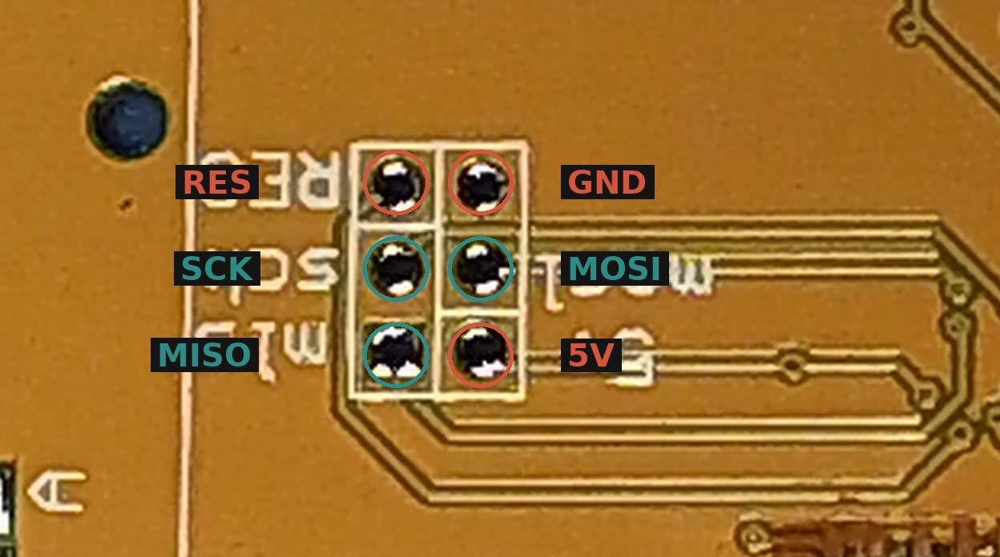

# 2. Tester firmware (one time)

You replace the factory firmware of the tester with **ComponentTester 1.57m** configured to
send its whole screen as text. You do this once, with a USBasp programmer.

> **Warning: this cannot be undone.** Factory firmware on these clones is read-protected, so
> you cannot back it up. The tester will keep working (better) with ComponentTester, but you
> can never go back to the factory software.

## 2.1 Solder the programming header

The 2×3 programming pads (labelled **RES, SCK, MISO, MOSI, 5V, GND** — on some boards the
labels are mirrored) are usually **under the display**.



1. Carefully fold the display away (it hangs on a thin flat cable — **do not bend that cable
   sharply**, it breaks easily).
2. Put the 2×3 header into the pads **from the component side**, so the pins stick out on the
   side with the chips.
3. Solder it from the display side and cut the pin ends flush, so they cannot touch the
   display frame.
4. Optional but useful: unsolder the 9 V battery clip now. With our firmware the tester runs
   from the ESP32 and never from the battery.

Expected result: a 2×3 header you can plug the programmer into.

## 2.2 Install the flashing program

You need **avrdude** (command line) or **AVRDUDESS** (a graphical front end for Windows).

| System | How |
|---|---|
| Windows | Download **AVRDUDESS** (it includes avrdude). For the USBasp you may need the driver from **Zadig** (choose *libusbK* for "USBasp"). |
| macOS | `brew install avrdude` |
| Linux | `sudo apt install avrdude` (Debian/Ubuntu) |

## 2.3 Connect the programmer

Connect the USBasp to the 2×3 header (10-to-6-pin adapter, or six jumper wires):

| Header pin | USBasp 10-pin connector |
|---|---|
| MOSI | 1 |
| 5V | 2 |
| RES | 5 |
| SCK | 7 |
| MISO | 9 |
| GND | 10 |

Leave the battery **disconnected**; the USBasp powers the board. Plug the USBasp into the computer.

## 2.4 Check the chip (important)

```bash
avrdude -c usbasp -p m328p
```

Expected result contains `device signature = 0x1e950f (probably m328p)`. If the signature is
different or the chip does not answer, stop here: it is not a genuine ATmega328P, or the
programmer wiring is wrong ([troubleshooting](07-troubleshooting.md)).

The warning `cannot set sck period; please check for usbasp firmware update` is harmless.

## 2.5 Flash

From the repository folder:

```bash
avrdude -c usbasp -p m328p -e -U flash:w:release/ComponentTester.hex:i -U eeprom:w:release/ComponentTester.eep:i
```

In AVRDUDESS: programmer **USBasp**, MCU **ATmega328P**, Flash file `ComponentTester.hex`,
EEPROM file `ComponentTester.eep`, tick **Erase flash and EEPROM**, press **Program!**.
Do **not** change the fuses.

Expected result: `... bytes of flash verified` and `... bytes of eeprom verified`.
If you see `verification mismatch`, run the same command again (it happened once in our tests
and the second run passed).

The tester's own display stays blank from now on — that is expected. Its screen now goes to the
ESP32 and you will see it in the browser.

Next: [3. Wiring and assembly](03-wiring-and-assembly.md)
