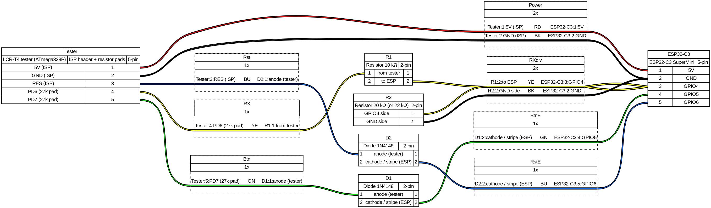
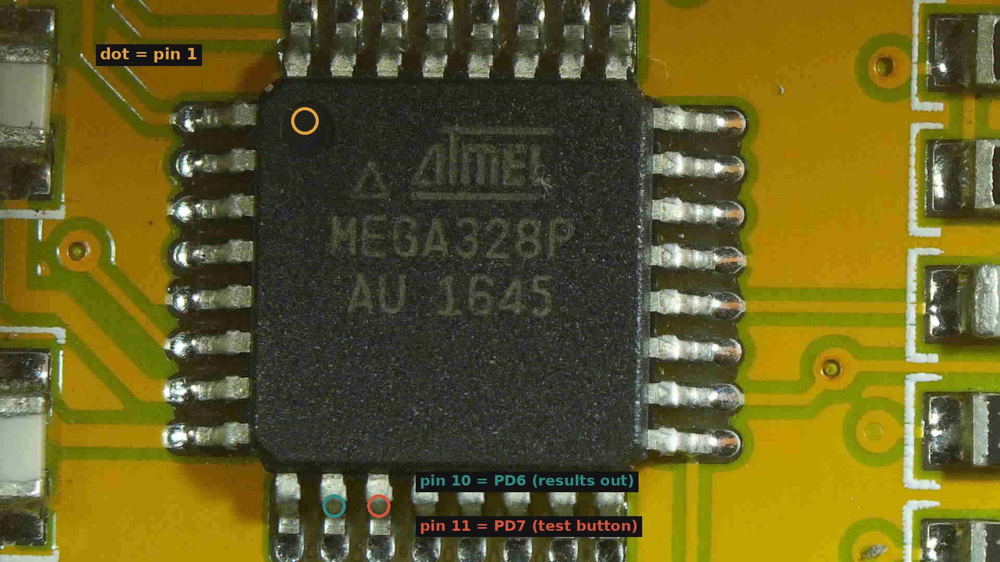
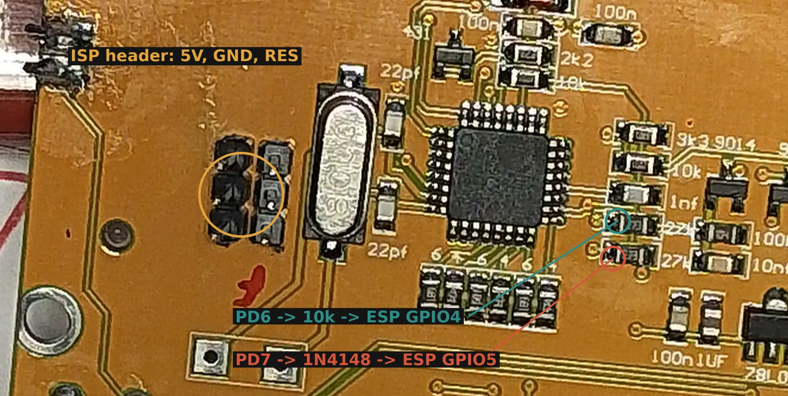

# 3. Wiring and assembly

Six connections, two resistors, two diodes. Unplug the USBasp first — the ESP32 takes over the
**5V**, **GND** and **RES** pins of the header.

| Tester | In between | ESP32-C3 SuperMini | Purpose |
|---|---|---|---|
| header **5V** | — | **5V** | power for the tester from the ESP32's USB |
| header **GND** | — | **GND** | common ground |
| **PD6** (pad of a 27 kΩ resistor, see photo) | **10 kΩ** in series | **GPIO4** (pin "4") | screen text from the tester, 9600 baud |
| — | **20 kΩ** from GPIO4 to GND | GPIO4 ↔ GND | divider: 5 V signal → 3.3 V for the ESP32 |
| **PD7** (pad of the other 27 kΩ resistor) | **1N4148**: anode at the tester, stripe (cathode) at the ESP32 | **GPIO5** | "presses" the test button |
| header **RES** | **1N4148**: anode at the tester, stripe (cathode) at the ESP32 | **GPIO6** | restarts the tester = new measurement |

The wiring source for WireViz is in [`wiring/wiring.yml`](wiring/wiring.yml).

## Where to find PD6 and PD7

The two signals come from pins 10 (PD6) and 11 (PD7) of the ATmega328P. Counting from the dot
(pin 1) anticlockwise, they are the **2nd and 3rd pin of the second side**:

Soldering directly to 0.8 mm chip pins is hard. On our board each of the two pins goes to a
**27 kΩ resistor** (marked `273`) right next to the chip; the pad on the chip side of each
resistor is an easy soldering point:

**Check with a multimeter** in continuity mode (beeper): one probe on chip pin 10, the other on
the resistor pad — it must beep. Same for pin 11. Your board may be routed differently; the
multimeter is the truth, not the photo.

## Steps

1. Solder the 10 kΩ resistor to the PD6 pad; its other end goes to ESP32 **GPIO4**.
2. Solder the 20 kΩ resistor between ESP32 **GPIO4** and ESP32 **GND**.
3. Solder a 1N4148 with its **anode** to the PD7 pad; its **striped end** goes to ESP32 **GPIO5**.
4. Solder the second 1N4148 with its **anode** to header **RES**; its **striped end** goes to
   ESP32 **GPIO6**.
5. Connect header **5V** to ESP32 **5V** and header **GND** to ESP32 **GND**.
6. Check with the multimeter that 5V and GND are not shorted.

Expected result: nothing happens until you plug in USB — then continue with
[chapter 4](04-esp32-install.md).

## Pitfalls

- **Diodes the wrong way round:** measurements still work (the tester repeats them on its own
  every ~6 s), but restart and button do nothing. The stripe must face the ESP32.
- **Wrong header pin for RES:** same symptom — `reset_banner: false` in `/measure` answers.
- **No battery:** do not connect the 9 V battery at the same time as USB.

Next: [4. ESP32 install and first start](04-esp32-install.md)
