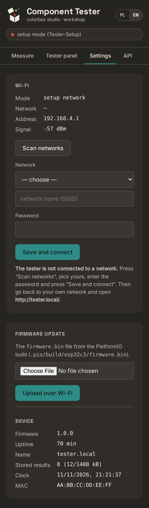

# 4. ESP32 install and first start

You flash a ready-made file from the browser — no programming tools needed.
(To build it yourself see [chapter 8](08-how-it-works.md#building-from-source).)

## 4.1 Flash the ESP32-C3

You need **Chrome** or **Edge** on a computer (they can talk to USB devices; Firefox and Safari cannot).

1. Plug the ESP32-C3 into the computer with a USB-C cable that carries data (some cables are
   charge-only).
2. Open <https://espressif.github.io/esptool-js/>.
3. Set **Baudrate** to 921600 and press **Connect**. Pick the port called *USB JTAG/serial
   debug unit* (or similar) and press **Connect** in the pop-up.
   If no port appears: unplug the board, hold its **BOOT** button, plug it in, release **BOOT**, try again.
4. In **Flash Address** enter `0x0`, choose the file `release/component-tester-esp32c3-full.bin`.
5. Press **Program**. Wait until the log shows `Leaving...` / `Hash of data verified`.
6. Unplug and plug the board back in (or press its **RST** button).

Expected result: within a few seconds a new open Wi-Fi network **Tester-Setup** appears.

## 4.2 Connect it to your Wi-Fi

The firmware contains no Wi-Fi password. On the first start (and whenever it cannot reach the
saved network) the tester opens its own network:

1. On a phone, join the Wi-Fi network **Tester-Setup** (no password).
2. The phone should show a sign-in page by itself (like hotel Wi-Fi). If it does not, open a
   browser and go to **http://192.168.4.1**.
3. The page opens the **Settings** tab and scans for networks by itself.

   

4. Pick your network under **Network**, type the **Password**, press **Save and connect**.
5. The tester restarts and joins your network. Put your phone back on your normal Wi-Fi.

## 4.3 Open the tester

On a computer or iPhone open **http://tester.local/**.

Some Android phones do not understand `.local` names. Then find the tester's address in your
router's list of connected devices (it is called `tester`) and open `http://<that address>/`.
Tip: reserve that address for the tester in the router (often called *DHCP reservation* or
*static lease*), so it never changes.

Expected result: the **Measure** page with a green dot and your network name in the top-right
corner.

## 4.4 Power

From now on the whole device is powered through the ESP32's USB-C socket — any phone charger
will do. The ESP32 gives the tester its 5 V. Do not connect the 9 V battery.

## 4.5 Self-adjustment (recommended, 2 minutes)

New firmware means default calibration values. Do this once:

1. Short all three contacts of the ZIF socket with a piece of wire.
2. Open the **Tester panel** tab. Wait until the screen shows a result (e.g. `1-[]-2-[]-3`).
3. Press **Menu (2× short)**. The screen shows `Select:` and a list.
4. Press **Short** until the star is at `*Adjustment`, then press **Long**.
5. When the screen shows `Remove Short Circuit!`, remove the wire.
6. Wait for the values (Ri-, Ri+, C0, R0, Vref, Vcc) and the menu to come back.
7. Press **Short** until `*Save`, then **Long**, then **Long** again on `#1`.

Details and what the numbers mean: [chapter 5](05-using.md#self-adjustment).

Next: [5. Everyday use](05-using.md)
