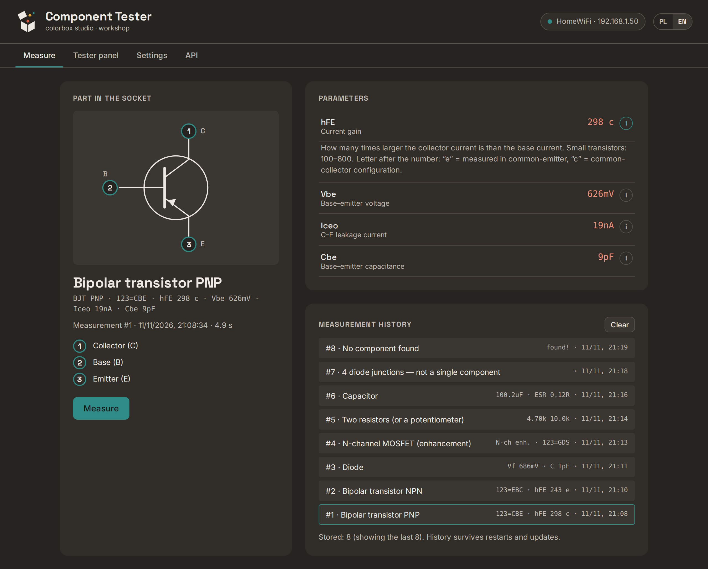
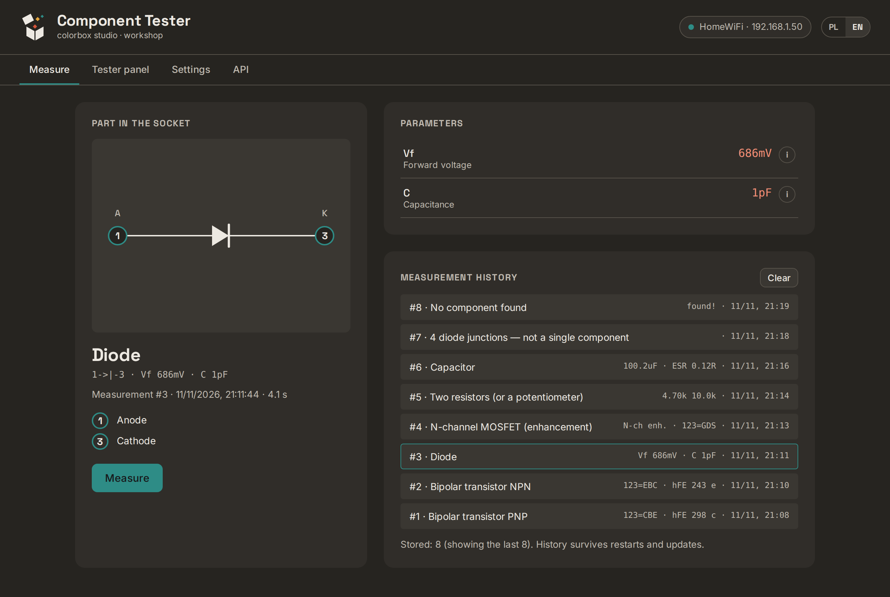
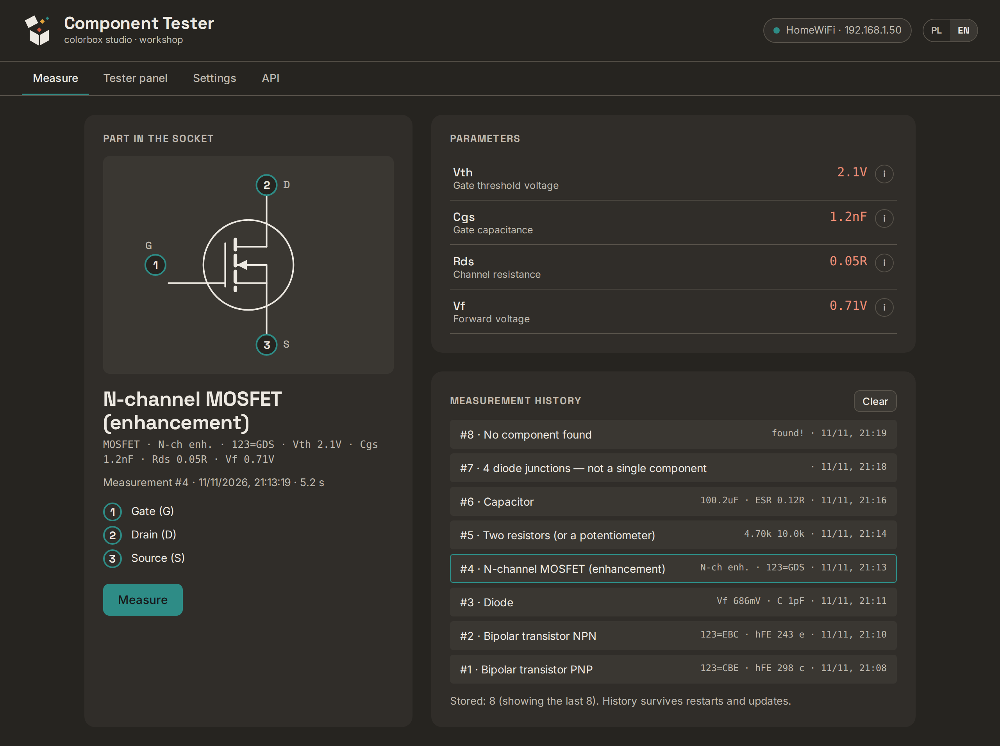
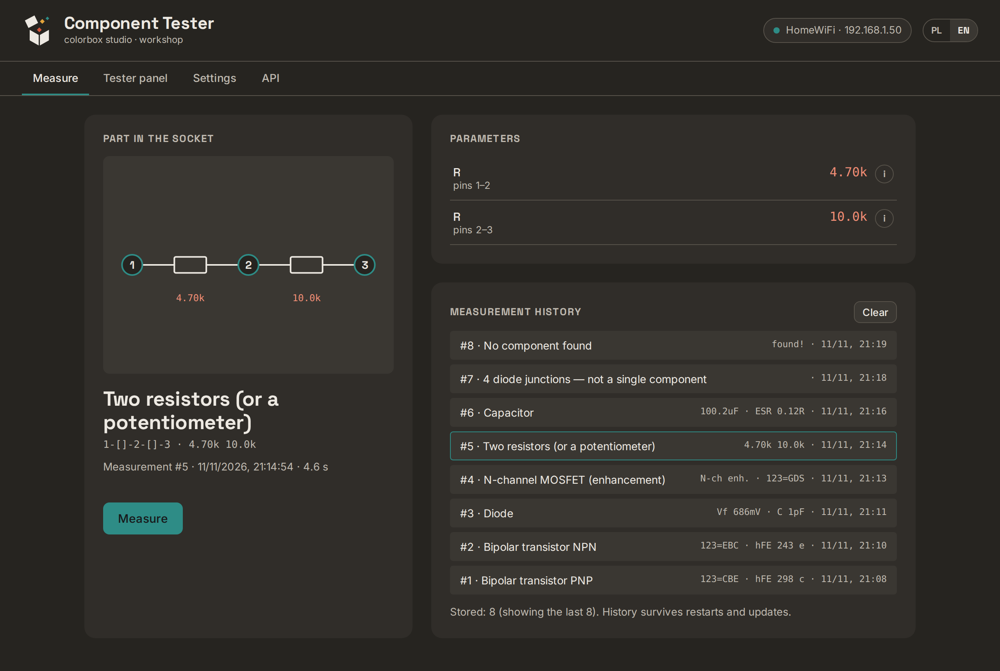
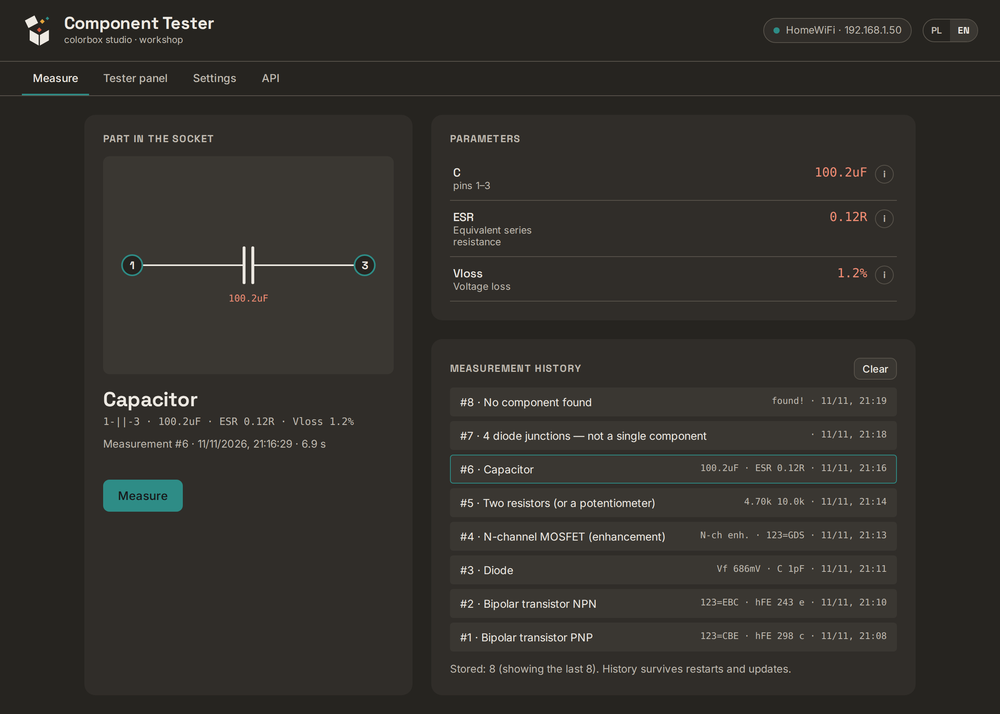
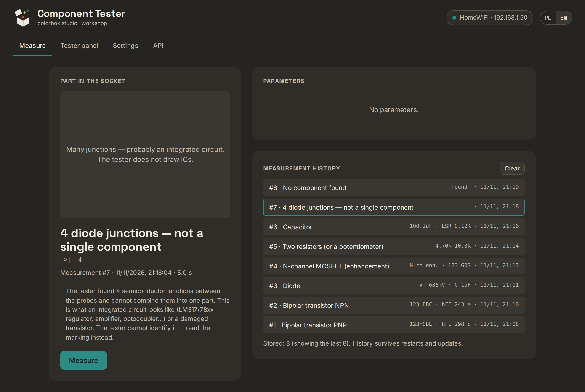
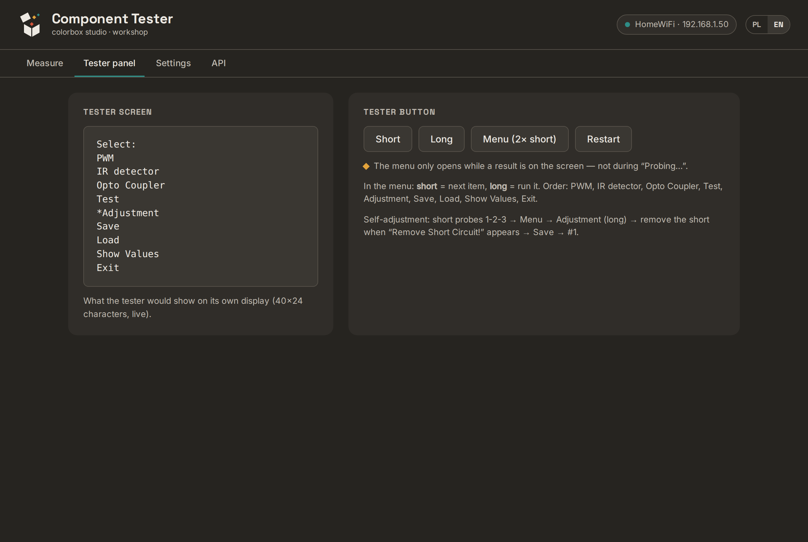
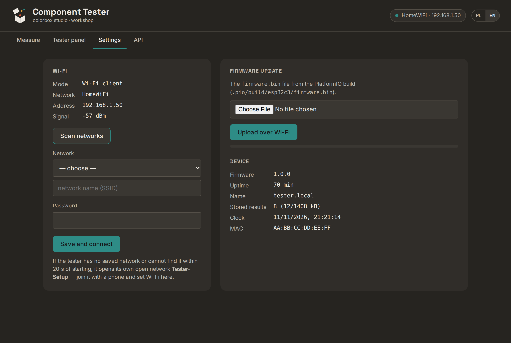

# 5. Everyday use

## Measuring

1. Put the part into the ZIF socket (any three contacts, in any order — the tester finds out
   which pin is which). Two-legged parts: any two contacts.
2. Press **Measure**. It takes about **5 seconds** (the tester restarts and measures).

You get:

- the **symbol** of the part with the socket contact numbers on its pins,
- the **name** (e.g. *Bipolar transistor PNP*) and the raw tester text below it,
- the **pin legend** (e.g. 1 = Collector, 2 = Base, 3 = Emitter),
- **Parameters** — press ⓘ next to any of them for a short explanation and typical values.

| Part | Example |
|---|---|
| Diode |  |
| MOSFET |  |
| Two resistors / potentiometer |  |
| Capacitor |  |

### What the tester can and cannot identify

It identifies **single** components: transistors, MOSFETs, JFETs, diodes and LEDs, resistors,
capacitors (with ESR), inductors, thyristors and triacs.

It **cannot** identify integrated circuits (voltage regulators like LM317/78xx, op-amps,
optocouplers…). Such parts give strange results — "4 diode junctions", or a "JFET" with
only one known pin (`x` = unknown pin). The page says so:

The tester also cannot tell the exact part number. "PNP, hFE 300" fits hundreds of
transistors — read the marking on the part.

Measure parts **out of circuit**. Discharge capacitors before measuring.

## History

Every measurement is stored on the device (the last **200**), with number and time. The list
**Measurement history** survives restarts and updates. Click an entry to see it again with
its symbol and parameters. Each measurement has its own link, e.g.
`http://tester.local/#result-12`. **Clear** deletes the whole history (asks first).

The time comes from the internet (NTP) about 20 seconds after start; entries made before that
show "time unknown".

## Tester panel

The left box shows the tester's own screen, live (40×24 characters). The buttons act like the
tester's push button:

| Button | Effect |
|---|---|
| **Short** | short press — next menu item |
| **Long** | long press — run the selected item |
| **Menu (2× short)** | double press — opens the menu |
| **Restart** | restarts the tester |

The menu only opens while a **result** is on the screen, not during `Probing...`.
Menu items: PWM, IR detector, Opto Coupler, Test, Adjustment, Save, Load, Show Values, Exit.

### Self-adjustment

Steps are in [chapter 4.5](04-esp32-install.md#45-self-adjustment-recommended-2-minutes).
The tester measures the resistance of its own socket and wiring and the internal resistance of
the chip pins, so that later measurements subtract them. Values from our unit for comparison:

| Value | Ours | Author's limit |
|---|---|---|
| R0 (socket + wiring) | 0.59 Ω | < 1.5 Ω for two probes |
| Ri- / Ri+ (chip pins) | 20.2 / 22.8 Ω | < 25 / < 29 Ω |
| C0 (socket capacitance) | 38 pF | < 100 pF |
| Vref | 1041 mV | — |
| Vcc | 5001 mV | — |

**Show Values** in the menu shows the stored values. Flashing the tester firmware again erases
them — repeat the adjustment afterwards.

## Settings

- **Wi-Fi:** current network, **Scan networks**, change network (**Save and connect** restarts the device).
- **Firmware update:** choose `release/component-tester-esp32c3-update.bin` (or your own
  `.pio/build/esp32c3/firmware.bin`) and press **Upload over Wi-Fi**. The settings and the
  history are kept. Do **not** upload the `-full.bin` file here.
- **Device:** firmware version, uptime, stored results, clock, MAC address.

## Language

**PL / EN** in the top-right corner. The choice is remembered by the browser.

Next: [6. API](06-api.md)
