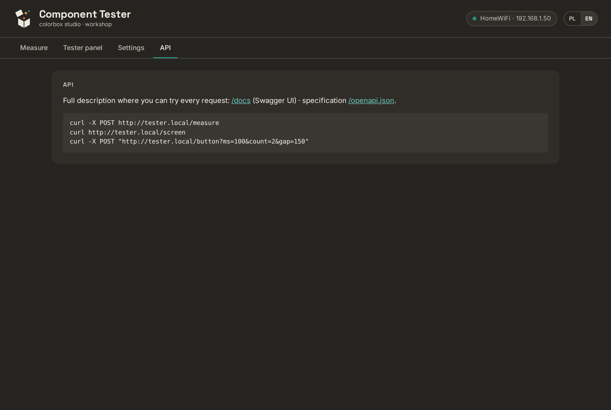

# 6. API

Everything the web page does is available over HTTP — for scripts, home automation, or AI
agents. There is **no password**: keep the tester on your home network, never expose it to the
internet.

Interactive documentation runs on the device: **http://tester.local/docs** (Swagger UI —
needs internet access in the browser to load its scripts). The machine-readable description
is at `/openapi.json` (also in the repository: `firmware/ui/openapi.json`).



## Endpoints

| Method | Path | What it does |
|---|---|---|
| POST | `/measure?mode=reset` | restart the tester, wait for the result (~5 s), store and return it |
| POST | `/measure?mode=button` | same, triggered by a button press |
| POST | `/measure?mode=next` | just wait for the next automatic measurement |
| GET | `/last` | last result |
| GET | `/results?limit=50` | stored results (max 200), oldest first |
| GET | `/result?id=12` | one stored result |
| POST | `/results/clear` | delete the history |
| GET | `/screen` | the tester's screen now: `rows`, `stable_ms` |
| GET | `/history` | last 20 stable screens |
| POST | `/button?ms=150` | short press; `ms=600` long; `ms=100&count=2&gap=150` double (menu) — returns the screen |
| POST | `/reset` | restart the tester |
| GET | `/wifi/scan` | visible networks |
| POST | `/wifi` | form fields `ssid`, `pass` — save and restart |
| POST | `/update` | multipart field `firmware` — new ESP32 program |
| GET | `/status` | version, uptime, Wi-Fi, storage, clock |

## Examples

```bash
curl -X POST http://tester.local/measure
```

```json
{"ms":4893,"lines":["BJT PNP","123=CBE","hFE 298 c","Vbe 626mV","Cbe 9pF"],
 "values":{"123":"CBE","hFE":"298 c","Vbe":"626mV","Cbe":"9pF"},
 "type":"BJT PNP","id":1,"ts":1794424079,"ok":true,"mode":"reset"}
```

- `lines` — the tester's text, exactly as printed.
- `values` — the same split into key → value. The key `123` is the **pinout**: `CBE` means
  socket contact 1 = Collector, 2 = Base, 3 = Emitter.
- `type` — first line. Two-terminal parts use a picture-like code: `1->|-3` diode (anode 1),
  `1-[]-3` resistor, `1-||-3` capacitor, `1-[]-2-[]-3` two resistors.
- `id`, `ts` — measurement number and Unix time (UTC; `0` if the clock was not synced yet).

Open the menu and move to the 5th item, from a script:

```bash
curl -X POST "http://tester.local/button?ms=100&count=2&gap=150"   # open menu
for i in 1 2 3 4; do curl -s -X POST "http://tester.local/button?ms=100" >/dev/null; done
curl http://tester.local/screen
```

## Without hardware

`python3 tools/tester_demo.py` serves the real web page at `http://localhost:8080/` with
made-up answers in the same format — handy for trying the API or changing the page.

Next: [7. Troubleshooting](07-troubleshooting.md)
