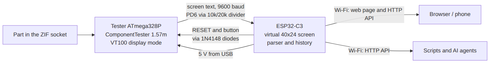

# 8. How it works

## The idea

The tester's microcontroller does all the measuring. ComponentTester has a **VT100 display
driver**: instead of drawing on an LCD it prints the screen as terminal text (with cursor
positioning codes) on a serial line. We send that line out of pin **PD6** at 9600 baud.
The ESP32 rebuilds a virtual 40×24 screen from it, decides when a result is complete, parses it
and serves it over Wi-Fi.



## Program structure (ESP32)

| File | Contents |
|---|---|
| `firmware/src/main.cpp` | everything on the ESP32: VT100 screen emulator, tester control (reset/button), result parser, history in LittleFS, Wi-Fi + setup network + captive portal, HTTP API, OTA update |
| `firmware/ui/index.html` | the web page (one file: HTML, CSS, JavaScript; symbol drawing, parameter hints, PL/EN texts) |
| `firmware/ui/openapi.json` | API description for Swagger |
| `firmware/tools_embed.py` | runs before every build: compresses the two files above into `src/assets.h` |
| `firmware/platformio.ini` | build settings (board `esp32-c3-devkitm-1`, Arduino framework, ArduinoJson) |

Key timings in `main.cpp`: a screen is "finished" after **600 ms** without changes; after a
restart the tester's banner (`Component Tester`, `v1.57m`) and `Probing...` are skipped; the
first non-transient screen is the result (about 4–5 s after the restart).

Wi-Fi: settings live in the ESP32's NVS memory. No saved network, or 20 s without
connecting at start, or 60 s lost later → open network **Tester-Setup** on channel 1 with
a DNS server that sends every name to `192.168.4.1`. While in that mode the ESP32 does not
scan in the background (that made phones fail to get an address) and retries the saved network
only every 5 minutes when no phone is connected.

History: one JSON object per line in `/results.jsonl` on the LittleFS partition (1.4 MB).
Above 300 entries the file is rewritten with the newest 200.

## Building from source

1. Install **PlatformIO**: either the VS Code extension "PlatformIO IDE", or the command line
   (`pip install platformio`).
2. In the `firmware/` folder:

   ```bash
   pio run -t upload        # build and flash over USB
   ```

   PlatformIO downloads the ESP32 toolchain by itself the first time (a few hundred MB).
3. Later updates: upload `.pio/build/esp32c3/firmware.bin` in **Settings → Firmware update**.

Changing the web page: edit `firmware/ui/index.html`, try it with
`python3 tools/tester_demo.py` (no hardware), then build. Screenshots in `docs/img/`:
`python3 tools/tester_screenshots.py` (needs `pip install playwright` and
`python3 -m playwright install chromium`).

Tester firmware: see [`tester-firmware/README.md`](../tester-firmware/README.md).

## Design decisions

| Decision | Why | Rejected alternative |
|---|---|---|
| Convert a cheap LCR-T4 | proven 5 V measuring circuit, mature open firmware | measuring on the ESP32 itself (noisy ADC, 3.3 V too low for MOSFET gates) |
| ComponentTester in VT100 mode | the whole UI including the menu and self-adjustment reaches the ESP32 | `UI_SERIAL_COPY` — sends results only, menus stay invisible |
| Software serial on PD6 | the hardware UART pins (PD0/PD1) are used by the display connector; PD6 is free once the soft power switch is disabled | hardware UART |
| Measurement = restart via RESET | starts a fresh measurement on demand (~5 s) | waiting for the automatic cycle (up to ~6 s more) |
| Result complete after 600 ms of silence | the tester never prints an explicit "end of result" | waiting for the next cycle's blank line |
| ESP32 does not program the ATmega | MOSI/MISO/SCK are also probe lines — a permanent connection would disturb measurements | in-circuit programming from the ESP32 |
| Diodes on RESET and button | the ESP32 can only pull the 5 V lines low; 5 V never reaches its 3.3 V inputs | direct connection |
| History in LittleFS | survives restarts and updates; the ESP32-C3 has no PSRAM, and PSRAM would be lost on power-off anyway | RAM |
| No password | meant for a home network only | password on settings |

## Known pitfalls (from building the prototype)

- The chip marking proves nothing — some clones carry fake "Atmel" chips. Check the signature.
- The flat cable of the display breaks easily when the display is folded away for soldering
  the programming header. (On the prototype it did — which is why the design does not need
  the display at all.)
- On battery power the clone's soft power circuit reset the chip in a loop; with 5 V from the
  ESP32 the battery circuit is simply unused.
- A plain multimeter reading (5 V at the regulator) does not show a voltage dip at start-up.
- The same transistor showed Vbe 946 mV when powered from the programmer and 622 mV from the
  ESP32's 5 V. Most likely the programmer supplied less than the 5.0 V the firmware assumes;
  after self-adjustment Vcc reads 5001 mV. Not verified with a meter.
- Integrated circuits give random results (an LM317 showed "4 diode junctions" once and a
  "JFET" with one known pin the next time).
